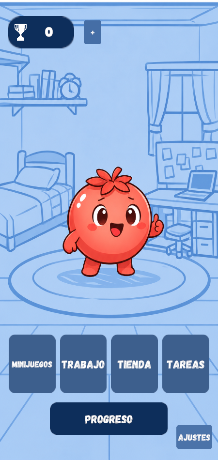
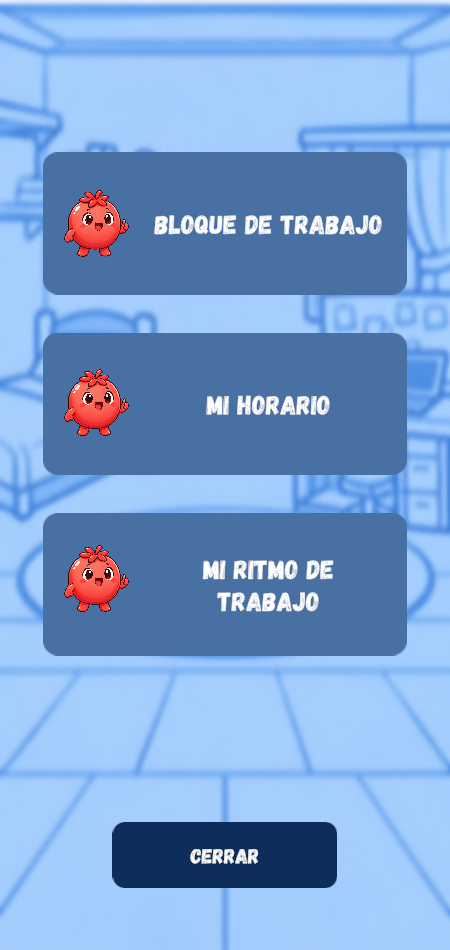
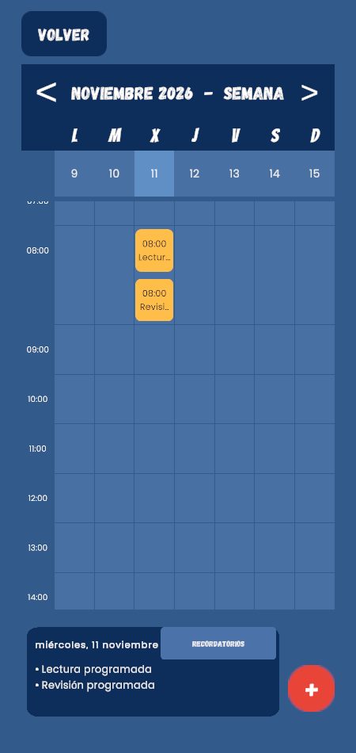
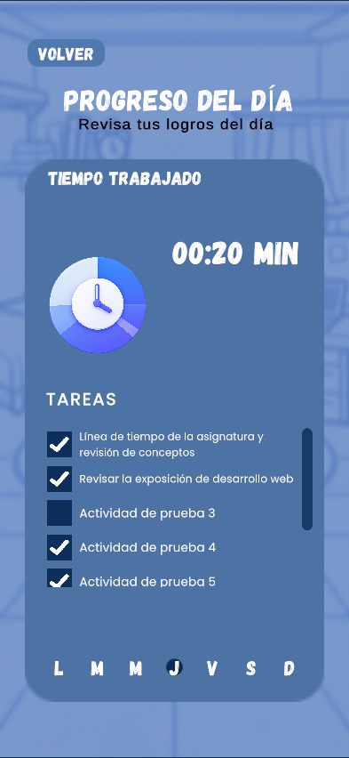
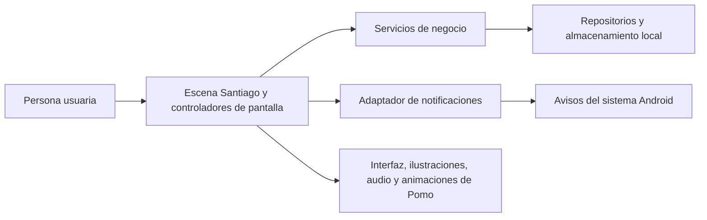

# POMO

POMO es una aplicación móvil para planificar tu trabajo, concentrarte y consultar tu progreso. Organiza tus pendientes en el calendario, trabaja en sesiones Pomodoro con descansos y revisa tu historial para identificar en qué horarios trabajas más. Al completar bloques, ganas copas que puedes canjear por atuendos para Pomo.

Desarrollado por **Nebuly Studios**.

[Guía de uso](#guía-de-uso) · [Ejecutar en Unity](#ejecutar-en-unity) · [Compilar para Android](#compilar-para-android) · [Arquitectura](#arquitectura) · [Repositorio en GitHub](https://github.com/SantiagoMejia064/POMO)

<p>
  
  
  
  
</p>

Capturas de POMO con datos de ejemplo.

## Guía de uso

| Desde Inicio | Qué puedes hacer |
| --- | --- |
| **Tareas** | Crea una tarea con **+** y ábrela para ver sus detalles. Pulsa **Comenzar** o **Completar** según su estado. Para borrarla, entra en **Editar tarea → Eliminar tarea** y confirma. |
| **Trabajo → Bloque de trabajo** | Elige un bloque de enfoque y descanso o crea uno personalizado. Puedes pausar y reanudar el temporizador. |
| **Trabajo → Mi horario** | Consulta tareas y recordatorios por mes, semana o día. |
| **Trabajo → Mi ritmo de trabajo** | Revisa en qué horas has registrado más actividad y programa recordatorios. |
| **Progreso** | Consulta el tiempo trabajado y el estado de tus tareas. La vista semanal compara tu actividad cuando hay suficientes datos. |
| **Tienda → Inventario** | Canjea copas por artículos. Equipa un artículo del inventario para verlo en Pomo al volver a **Inicio**. |
| **Minijuegos → Memoria** | Voltea cartas, encuentra parejas y consulta el resultado de la partida. |
| **Ajustes** | Configura el sonido y la vibración, consulta el aviso de privacidad y administra tus datos locales. |

### Planifica y completa una sesión

1. En **Tareas → +**, crea **Revisar propuesta**, escribe **Proyecto personal** en el campo de asignatura y elige una fecha futura con el formato `DD/MM/AAAA`. Guarda la tarea.
2. En **Trabajo → Mi horario**, selecciona esa fecha para consultar la tarea.
3. En **Trabajo → Bloque de trabajo**, crea un bloque con **1 minuto de enfoque** y **1 minuto de descanso** para recorrer el flujo completo. Selecciónalo, inicia el bloque y deja terminar el enfoque.
4. Vuelve a **Tareas**, pulsa **Comenzar** y después **Completar**. En **Progreso diario**, selecciona el día actual para consultar el tiempo registrado y ver la tarea marcada como completada.

## Ejecutar en Unity

Necesitas **Unity Hub**, **Unity 6.3 LTS (`6000.3.11f1`)** y conexión a internet para descargar el Editor y los paquetes en la primera apertura. Usa la versión indicada en [ProjectVersion.txt](ProjectSettings/ProjectVersion.txt).

1. Descarga el proyecto desde **Code → Download ZIP** en GitHub y descomprímelo, o clónalo con Git.

   ```bash
   git clone https://github.com/SantiagoMejia064/POMO.git
   cd POMO
   ```

2. En Unity Hub, ve a **Projects → Add → Add project from disk** y selecciona la carpeta que contiene `Assets`, `Packages` y `ProjectSettings`.
3. Abre el proyecto y espera a que Unity termine de importar los recursos. En la ventana **Project**, abre **Assets → Scenes → Santiago**.
4. Presiona **Play** y usa la pestaña **Game**. Selecciona una relación vertical **9:16** o usa **Simulator** para ver la interfaz en un teléfono virtual.
5. En el primer ingreso, lee y acepta el aviso de privacidad, introduce tu nombre y completa el recorrido de hábitos hasta llegar a **Inicio**.

Para volver a probar la bienvenida desde cero, usa una instalación de prueba. La opción de borrado en **Ajustes** elimina los datos locales de POMO después de confirmar.

## Compilar para Android

1. En Unity Hub, añade **Android Build Support**, **Android SDK & NDK Tools** y **OpenJDK** a la instalación de `6000.3.11f1`.
2. En Unity, abre **File → Build Profiles** y activa el perfil **Android**. En la lista de escenas habilitadas debe figurar `Assets/Scenes/Santiago.unity`.
3. Desactiva **Export Project** y **Build App Bundle (Google Play)** para generar un APK. Usa **Build** y elige el destino, por ejemplo `Builds/POMO.apk`.
4. Para instalar directamente desde el Editor, conecta un teléfono Android compatible con **ARM64**, activa la depuración USB, selecciona el teléfono en **Run Device** y pulsa **Build and Run**.

El Editor permite recorrer las pantallas y guardar datos de prueba. Para comprobar la recepción de avisos, los permisos de notificación, la vibración o TalkBack, usa un dispositivo Android. [Manual de compilación para Android en Unity 6.3](https://docs.unity.com/en-us/engine/6000.3/manual/platform-specific/android/building-and-delivering/build-process)

## Arquitectura

- **Unity 6.3 LTS y C#** para la aplicación, sus pantallas y la lógica de trabajo.
- **Unity UI (uGUI) y TextMesh Pro** para la interfaz, **Universal Render Pipeline (URP)** para el renderizado y **Mobile Notifications** para los avisos de Android. [Versiones de los paquetes](Packages/manifest.json)
- **JSON local** para tareas, bloques, progreso, inventario y recordatorios. **PlayerPrefs** guarda datos del perfil y preferencias. [Persistencia y recuperación](Docs/Sprint4-Steven-Implementacion-y-pruebas.md#datos-locales-y-recuperación)



| Carpeta | Contenido |
| --- | --- |
| [`Assets/Scenes`](Assets/Scenes) | Escena principal `Santiago.unity` y escenas de desarrollo. |
| [`Assets/Scripts/Presentation`](Assets/Scripts/Presentation) | Controladores de pantalla, navegación, vistas y retroalimentación. |
| [`Assets/Scripts/Business`](Assets/Scripts/Business) | Reglas de tareas, temporizador, progreso, minijuego y tienda. |
| [`Assets/Scripts/Data`](Assets/Scripts/Data) | Modelos, repositorios y persistencia. |
| [`Assets/Scripts/ServicesAdapters`](Assets/Scripts/ServicesAdapters) | Adaptadores para servicios de plataforma, como las notificaciones. |
| [`Assets/Prefabs`](Assets/Prefabs) y [`Assets/Images`](Assets/Images) | Componentes reutilizables y recursos visuales. |
| [`Packages`](Packages), [`ProjectSettings`](ProjectSettings) | Dependencias y configuración del proyecto. |
| [`Docs`](Docs), [`Tools`](Tools) | Documentación técnica, capturas y herramientas de validación. |

## Desarrollo y validación

- [Diseño de interfaz](Docs/POMO-Refactor-visual-Canva.md) · [Prototipo en Canva](https://canva.link/9wtzw0gbvkfy45p)
- [Ritmo y recordatorios](Docs/Sprint3-Ritmo.md) · [Memoria](Docs/Sprint3-Memoria-Implementacion-y-validacion.md) · [Logros](Docs/Sprint3-Pomo-Logros-Implementacion-y-validacion.md) · [Progreso semanal](Docs/Sprint3-Pomo-Desempeno-Implementacion-y-validacion.md)
- [Privacidad](Docs/Sprint4-Santiago-Privacidad.md) · [Permisos en Android](Docs/Sprint4-Santiago-Permisos.md) · [Borrado de datos](Docs/Sprint4-Santiago-Borrado.md) · [Resultados de regresión](Docs/Sprint4-Santiago-Regresion.md)

### Pruebas funcionales

| Caso | Pasos | Resultado esperado |
| --- | --- | --- |
| Tareas y calendario | Crea una tarea, consúltala en Mi horario y cambia su fecha desde la edición. | La tarea aparece en la nueva fecha. |
| Sesión y progreso | Completa el enfoque de un bloque y vuelve a entrar en Progreso. | La sesión se refleja en el historial y la recompensa se acredita una vez. |
| Compra y atuendo | Compra un artículo con saldo suficiente, equípalo en Inventario y vuelve a Inicio. Cierra y abre la app. | Pomo aparece con el atuendo equipado y la selección se conserva. |
| Aviso en Android | Concede los permisos que solicite POMO y programa un recordatorio futuro en Ritmo. | La confirmación refleja el estado de programación y el teléfono recibe el aviso a la hora elegida. |

Los scripts de revisión técnica se ejecutan desde la raíz del proyecto. Para los scripts `.ps1`, usa PowerShell en Windows con Unity ya instalado y el proyecto importado. El comando `.cjs` requiere Node.js.

```powershell
./Tools/TestNotificationPermissions.ps1
./Tools/CheckSantiagoSceneYaml.ps1
node Tools/CheckSantiagoInteraction.cjs
```

## Materiales pendientes de publicación

- Demo público y descarga del APK.
- Video de presentación de POMO.
- Video de pruebas de uso.
